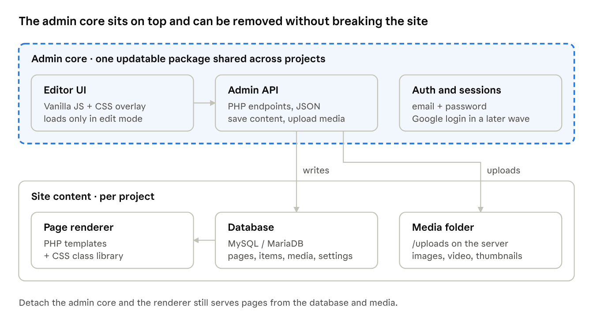
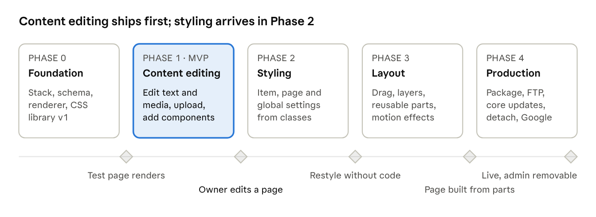

# Visual Editor – Project Brief

Nov 22, 2026 · @kubaS

## Overview & aim

A lightweight, edit-what-you-see visual editor that attaches to simple
websites, mostly portfolios, and lets the owner manage content and its
styling directly on the page.

- **Content:** text, images and video, placed and replaced in place on
  the live page layout.

- **Styling:** chosen from a predefined library of CSS classes (layout,
  typography, transitions, animations), never free-form CSS. Styling
  management arrives in Phase 2, after content editing.

- **Architecture:** a reusable, updatable **admin core** that sits on
  top of project-specific **content**. If the admin layer is removed,
  the site keeps working as a plain website.

- **Target sites:** visual pages that rely on image positioning,
  responsive layouts, container queries and CSS-driven motion.

## Core features

Everything is edited on the rendered page itself. An **edit mode
switch** shows or hides the editor layer.

### Editing in place

- Edit what you see: text, captions and headings directly on the page.

- Replace an image or video in its container.

- Drag items to change their position.

- Layers panel for sorting and reordering items in a container.

### Components

- Add modules from a predefined component library.

- Repeat or duplicate a component.

- Save any component as a **reusable component**, so editing the master
  updates every instance.

- **Unlink** an instance so it can be edited on its own.

### Media

- Upload media to the project: multiple images and videos at once.

- Uploaded media is stored as thumbnails in a **media tray**.

- Two ways to place media:

  1.  **Container first:** add a row or column placeholder, pick media
      from a dropdown of uploaded items, and it fills the container.
      Then set width, aspect ratio and a predefined animation.

  2.  **Tray first:** pick a thumbnail from the tray and drop it onto
      the page.

- Image fit and position within its container (cover, contain, focal
  point).

### Page meta

- Custom slug per page.

- Social share image (OG thumbnail) per page.

## Settings levels

Settings cascade from global to page to item. The more specific level
overrides the broader one.

| Level  | Settings                                                                                                                            |
|--------|-------------------------------------------------------------------------------------------------------------------------------------|
| Global | Colour palette, background colour, light/dark mode, animation timing, border radius for media containers, buttons and form inputs   |
| Page   | Background colour, font colour, full width, predefined grid, parallax scrolling items, fullscreen slider                            |
| Item   | Background colour, font colour (caption if present), animation (fade-in, slide-in…), position (sticky, fixed…), width, aspect ratio |

Global settings map naturally to CSS custom properties (--color-bg,
--radius-media, --anim-duration), so a change updates the whole site
without touching markup.

## Styling & animation library

All styling is applied by toggling predefined CSS classes. The library
is defined upfront and grows as maintenance and development continue,
for example a scroll-reveal effect or fake parallax added later.

- **Layout:** grids, rows/columns, full width, container queries for
  responsive modules.

- **Media fit:** cover, contain, focal-point positioning, aspect ratios.

- **Typography:** predefined type scale and styles, responsive.

- **Transitions & animations:** fade-in, slide-in, scroll reveal,
  parallax, all as CSS classes, with JS only where needed (e.g. an
  IntersectionObserver to trigger reveals).

- **Position:** sticky, fixed.

Each class is registered in a manifest (name, label, group, icon), so
the editor UI builds its pickers from the manifest instead of
hard-coding them. Adding a style = add CSS + one manifest entry.

## Editor UI principles

- **Minimal:** the editor stays out of the way of the content. A
  floating toolbar and contextual item panels only.

- **Icons:** simple icons, possibly pixel-art from [Pixelarticons
  Mini](https://pixelarticons.com/mini/).

- **One-step edits by default:** changes apply immediately.

- **Two-step only for destructive actions:** delete (or similar) opens a
  confirmation dialog before the action runs.

- **Isolated:** editor CSS and JS are namespaced so they never clash
  with site styles.

## Architecture & tech stack

The system is split into a shared **admin core** and per-project
**content**, built with plain PHP, vanilla JS and CSS, with no build
step.

architecture · admin core over site content

### Admin core vs content

- **Admin core:** editor UI, admin API, auth. The same package is copied
  into each project and can be updated on its own, with no ties to any
  project's content.

- **Content:** page templates, CSS class library, database records and
  media. It belongs to the project.

- **Detachable:** when a project ends (client leaves, maintenance
  stops), the admin folder is removed or disabled. The site does not
  crash. Pages render from the DB as before and the editing layer is
  simply no longer there.

- Core updates ship as a versioned folder with DB migrations, so one
  improvement can be rolled out across all projects.

### Stack

| Layer           | Choice                                                                                             |
|-----------------|----------------------------------------------------------------------------------------------------|
| Server language | PHP (runs on MAMP and on standard shared hosting)                                                  |
| Front end       | Vanilla JS (ES modules) + CSS. Avoid Node, React and JS build tools                                |
| Database        | MariaDB / MySQL to start. PostgreSQL kept as an option via PDO                                     |
| Local dev       | MAMP on localhost (MySQL)                                                                          |
| Production      | MariaDB on the live server                                                                         |
| Deployment      | A build folder/package uploaded via FTP, plus a simple config file with DB name, user and password |

## Local dev setup

The project runs on MAMP at /Users/kuba/Sites_MAMP/visualeditor with the
MySQL database visualeditor00_DB (user root, password root, local only).

1.  **Configure MAMP:** set the document root to /Users/kuba/Sites_MAMP
    (or the project folder itself), PHP 8.2+, and note the ports (MAMP
    default: Apache 8888, MySQL 8889).

2.  **Create the database:** in phpMyAdmin (MAMP start page), create
    visualeditor00_DB with collation utf8mb4_unicode_ci.

3.  **Create the folder structure:**

    - /admin/: admin core (editor JS/CSS, API endpoints, auth,
      migrations). Self-contained and removable.

    - /site/: page templates, partials, the CSS class library and the
      style manifest.

    - /uploads/: media files and generated thumbnails (writable).

    - /config/config.php: DB host, port, name, user, password, base URL.
      Kept out of git, with a config.example.php beside it.

    - index.php: front controller that resolves slugs and renders pages,
      and loads /admin/ only if it exists and the user is logged in.

4.  **Connect with PDO:** one small db.php helper using PDO (host
    localhost, port 8889, charset utf8mb4). PDO keeps the
    MySQL/MariaDB/PostgreSQL switch open.

5.  **Run the first migration:** SQL files in /admin/migrations/ create
    the starter tables: pages, items (page, parent, order, type, content
    JSON, classes), components, media, settings, users.

6.  **Seed a test page:** one page with a few items, rendered by
    index.php, to confirm the stack end to end.

7.  **Version control:** git init, with .gitignore covering
    config/config.php and /uploads/.

8.  **Pretty URLs:** an .htaccess rewrite sending all non-file requests
    to index.php, so custom slugs work locally and on Apache hosting.

## Development phases

The MVP is content editing on fixed templates. Styling, layout freedom
and distribution follow in that order, and each phase ends at a gate
that must pass before the next starts.

roadmap · 5 phases, a gate after each

### Phase 0: Foundation

- [ ] Local setup as above: MAMP, DB, folder structure, config, PDO
  helper

- [ ] DB schema v1 + migrations runner

- [ ] Front controller + page renderer from DB (no admin)

- [ ] CSS class library v1 + style manifest

- [ ] One seeded portfolio page

**Gate:** the test page renders from the DB with the admin folder
absent.

### Phase 1: Content editing (MVP)

- [ ] Login with email + password, sessions, logout

- [ ] Edit mode show/hide switch; editor assets load only when logged in

- [ ] Inline text editing, saved to DB

- [ ] Media upload (multiple images and videos) + thumbnail tray

- [ ] Replace image/video in a container (pick from tray)

- [ ] Add items from a small predefined component library; repeat
  components

- [ ] Delete with confirmation dialog

- [ ] Page meta: custom slug, social share image

**Gate:** the site owner updates a portfolio page end to end without
touching code.

### Phase 2: Styling from predefined classes

- [ ] Item settings: background, font colour, animation, position,
  width, aspect ratio, image fit/focal point

- [ ] Page settings: background, font colour, full width, predefined
  grid

- [ ] Global settings as CSS variables: colours, light/dark mode,
  animation timing, border radius

- [ ] Pickers generated from the style manifest

**Gate:** a page can be fully restyled without editing CSS.

### Phase 3: Layout & components

- [ ] Drag to reposition; layers panel for sorting

- [ ] Add row/column placeholder → pick media from dropdown → set params

- [ ] Reusable components (master/instance) + unlink instance

- [ ] Extended motion: scroll reveal, parallax items, fullscreen slider

- [ ] Responsive checks with container queries; preview at breakpoints

**Gate:** a new page is built from components alone.

### Phase 4: Production-ready add-on

- [ ] Build script that produces an upload package (admin core + site +
  example config)

- [ ] FTP deployment guide; DB import/export between localhost and live

- [ ] Admin core versioning + update mechanism with migrations

- [ ] Detach procedure, tested: remove /admin/, site keeps working

- [ ] Security: password hashing, CSRF tokens, upload type/size checks,
  rate-limited login

- [ ] Backups of DB and uploads

- [ ] Google login (next wave)

**Gate:** deployed to a live client site, and removing the admin core
leaves it intact.

## Open questions

- [ ] Production DB: MariaDB confirmed, or keep PostgreSQL support from
  day one?

- [ ] Content storage: one JSON blob per item, or typed columns per
  field?

- [ ] Rendering on detach: keep PHP rendering from the DB, or export
  static HTML when a project ends?

- [ ] Admin core updates: manual FTP copy, or a version check that pulls
  updates from a central source?

- [ ] Media: generate resized versions and WebP on upload (needs
  GD/Imagick on the host)?

- [ ] Multiple editors per site, or a single owner account?
